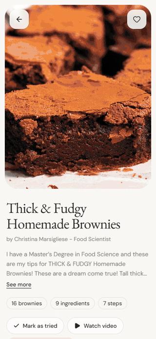
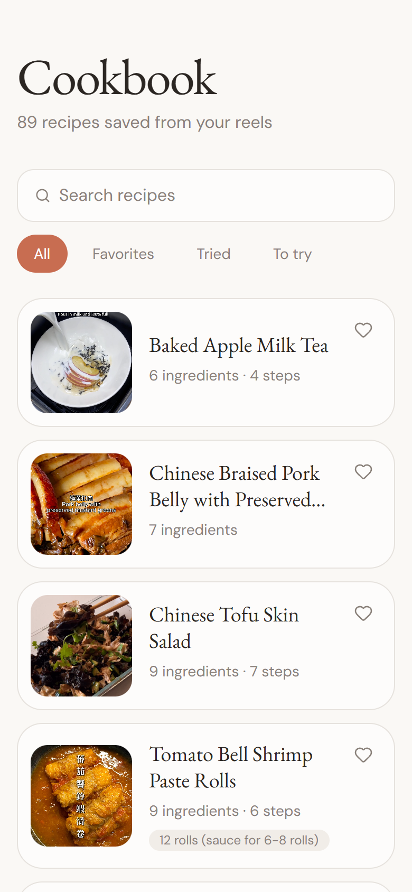
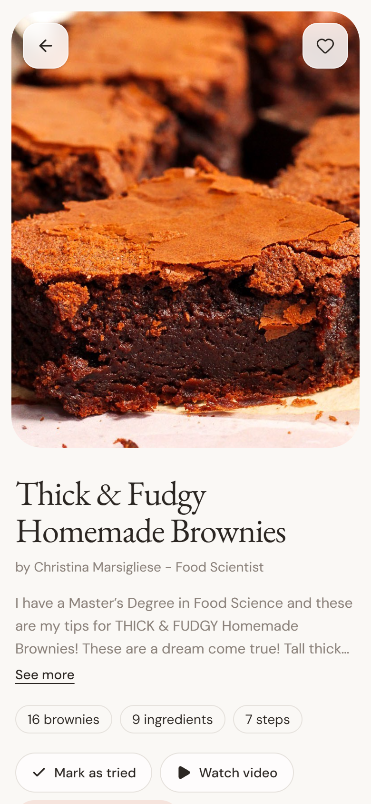
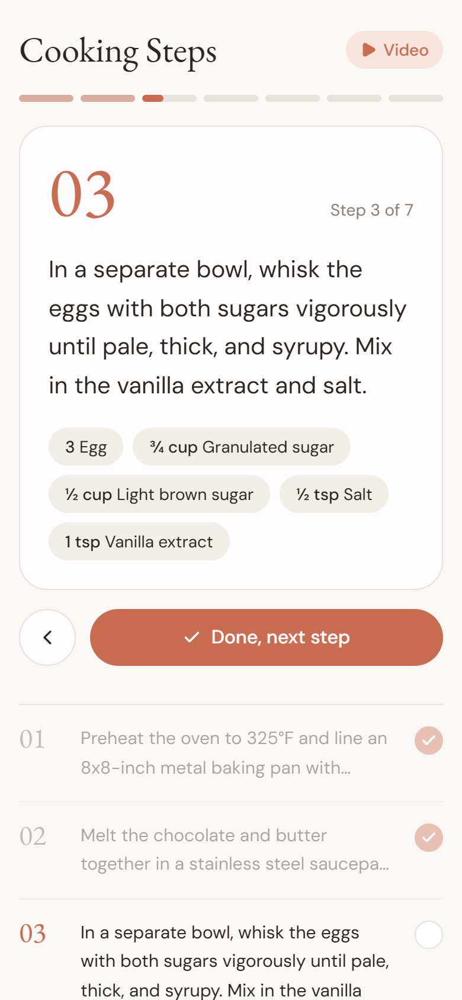
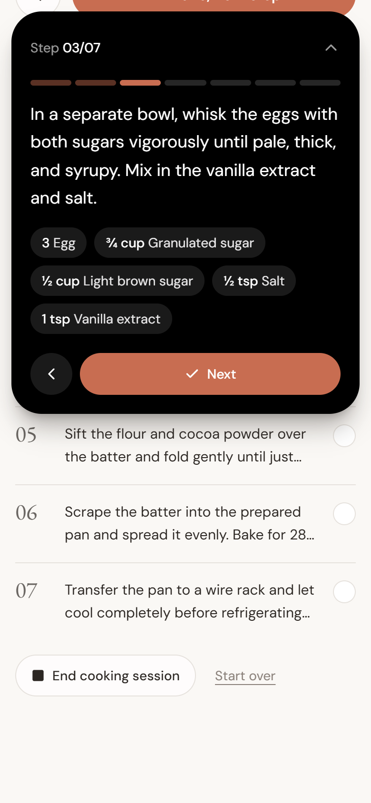

# Recipe Pantry

Turns the cooking reels you save into real recipes, then lets you cook along step by step.
Paste an Instagram, YouTube or TikTok link: the app transcribes it, reads the on-screen text
and the creator's recipe page if needed, and a **local LLM** extracts the ingredients and
method. No cloud APIs: everything runs on your own machine.

<p align="center">
  
</p>

<p align="center">
  
  
  
  
</p>

**Tech:** Python · yt-dlp · faster-whisper · EasyOCR · Ollama (local LLM, JSON-schema output) ·
SQLite · FastAPI · Next.js · Tailwind · Framer Motion · pytest (214 tests)

**In use:** 115 saved posts processed, 89 turned into recipes with ingredients, most with
step-by-step methods. Recipe thumbnails and text belong to their creators, credited on each
recipe page. A mobile-first web app ([Web app](#web-app)) is the cooking interface.

```
URL ──yt-dlp──► metadata + captions + audio
                     │
                     ├─ captions good? ──► transcript
                     └─ else faster-whisper ──► transcript
                                                   │
         title + description + transcript ──► Ollama (qwen2.5:7b, JSON schema)
                                                   │
          too few ingredients / no amounts? ──► video frames ──EasyOCR──► on-screen text
                                                   │                        └─► re-parse
                         normalize names/units ──► SQLite
                                                   │
           selected ingredients ──► recipes using the most of them, fewest extras first
```

## Demo

Real output from my own database of about 90 recipes saved from Instagram reels.

**What can I cook with what's in the fridge?** Recipes that use the most of the selected
ingredients come first; ties go to the one needing the fewest other ingredients.

```
$ python main.py pantry flour sugar "brown sugar" honey yeast eggs "baking soda" --limit 3
1. [54] Bakery Style Chocolate Chip Cookies  (uses 5 of 7 selected; +4 more)
     uses:       baking soda, egg, flour, honey, sugar
     also needs: butter, dark brown sugar, dark chocolate, pure vanilla extract
     instagram.com/p/DWZPP4xD2FE

2. [29] Black Sesame Swirl Banana Bread  (uses 5 of 7 selected; +6 more)
     uses:       baking soda, brown sugar, egg, flour, sugar
     also needs: banana, black sesame paste, buttermilk, ground cinnamon, olive oil, vanilla bean paste
     instagram.com/p/DU05oN_DkAN

3. [1] Salted Maple Banana Bread  (uses 5 of 7 selected; +6 more)
     uses:       baking soda, brown sugar, egg, flour, sugar
     also needs: banana, butter, buttermilk, maple syrup, molasses, vanilla paste
     instagram.com/p/DZlOp2nJL4I
```

**A stored recipe, parsed from the reel's caption and speech:**

```
$ python main.py show 55
Salted Maple Banana Bread
instagram.com/p/DZva78zpQuq
Ingredients from description, speech; transcript: whisper
Makes: 1 standard loaf pan

  - 0.75 cup butter
  - 1 cup brown sugar
  - 0.33 cup white sugar
  - 1.33 cup mashed banana
  - 2 egg
  - 1.5 tsp vanilla paste
  - 1 tsp molasses
  - 2 cup all-purpose flour
  - 1 tsp baking soda
  - 1 tsp salt
  - 4 oz buttermilk
  - 0.5 cup maple syrup
  - flaky sea salt
```

Salt, pepper, water and oil count as pantry staples, so they never show up as missing.
Links are shortened here; the CLI prints full URLs.

Recipes by their original creators:
[Classic Japanese Bagel](https://www.instagram.com/p/CzJiZmOLfaW/) ·
[No-Yeast Youtiao](https://www.instagram.com/p/C188sW2PfKU/) ·
[Honey Butter Toast](https://www.instagram.com/p/C63hOr1ysaW/) ·
[Salted Maple Banana Bread](https://www.instagram.com/p/DZva78zpQuq/)

## Layout

```
config.py              settings from RECIPE_* env vars / .env
main.py                CLI
pipeline/
  downloader.py        yt-dlp: metadata, captions (VTT -> text), audio; video for OCR
  ocr.py               ffmpeg frame sampling + EasyOCR -> distinct on-screen text lines
  transcriber.py       faster-whisper (model cached, VAD on)
  parser.py            prompt + Ollama call with JSON-schema output, pydantic validation
  ingest.py            orchestrates the above and saves the result
  urls.py              canonical URLs (share-link variants -> one key), batch file reading
  thumbnails.py        saves each video's thumbnail under data/thumbnails/
api/app.py             FastAPI JSON server for the web app
web/                   Next.js + Tailwind + Framer Motion app (cookbook, recipe, cooking mode)
db/
  schema.py            recipes / ingredients / recipe_ingredients + connect()
  normalize.py         canonical ingredient names and units
  repository.py        save_recipe (upsert by URL), get_recipe, list_recipes
  pantry.py            find_recipes_by_pantry
  step_ingredients.py  which ingredient lines each step mentions
tests/
```

## Setup

Prerequisites: Python 3.10+, [Ollama](https://ollama.com), and ffmpeg on PATH (yt-dlp
uses it for some sites).

```powershell
# Windows PowerShell
python -m venv .venv
.\.venv\Scripts\Activate.ps1
pip install -r requirements-dev.txt
copy .env.example .env      # optional
ollama pull qwen2.5:7b
```

```bash
# macOS / Linux / Git Bash
python -m venv .venv
source .venv/bin/activate        # Git Bash on Windows: source .venv/Scripts/activate
pip install -r requirements-dev.txt
cp .env.example .env
ollama pull qwen2.5:7b
```

The first transcription downloads the Whisper model (`small` is about 500 MB) into the
Hugging Face cache.

**On-screen text (optional):** `pip install -r requirements-ocr.txt` adds EasyOCR (and CPU
PyTorch, a few hundred MB; its models download on first use). With `RECIPE_OCR=auto`
(default), a video whose description and speech give fewer than 3 ingredients, or no
amounts, is downloaded again as video, sampled at `RECIPE_OCR_FPS` (near-identical frames
dropped, at most `RECIPE_OCR_MAX_FRAMES`), OCR'd, and re-parsed with that text. This adds
a few minutes per video on CPU. `RECIPE_OCR=always` does it for every video, `off` never.
Without EasyOCR installed the fallback is skipped with a warning.

**GPU transcription:** set `RECIPE_WHISPER_DEVICE=cuda` and `RECIPE_WHISPER_COMPUTE_TYPE=float16`.
This needs the CUDA 12 cuBLAS and cuDNN 9 libraries; see the faster-whisper README.

## Usage

```bash
python main.py ingest "https://www.youtube.com/shorts/<id>" "https://www.instagram.com/reel/<id>/"
python main.py batch --file urls.txt            # add --refresh to re-parse stored URLs
python main.py list                            # recipes ready to cook
python main.py list --todo                     # posts whose recipe is on a blog / in the bio / by DM
python main.py list --all                      # everything, including non-recipe videos
python main.py show 1
python main.py import-page 34                  # read a post's ingredients from its linked blog recipe
python main.py import-page 63 --url https://...   # ... or from a recipe page you found yourself
python main.py import-page 39 --file "Lemon Curd Cookies.html"   # site blocks the app: save the page (Ctrl+S)
python main.py import-page 45 --file ingredients.txt               # ... or paste the ingredient list
python main.py reparse 12 15                   # run the model again on saved recipes (no download)
python main.py reparse --missing-steps         # add steps to recipes saved before steps existed (~2 min each)
python main.py renormalize --dry-run          # re-apply name normalization to stored recipes
python main.py thumbnails                      # save missing video thumbnails (for the web app)
python main.py search --ingredients "chicken, garlic, soy sauce, rice, eggs" --limit 10
python main.py pantry eggs butter --json        # same query, space-separated
```

**Duplicates.** Recipes are keyed by a canonical URL, so `/reel/<id>/?igsh=...` and
`/p/<id>/` (or `youtu.be/<id>` and `/shorts/<id>`) are the same recipe. `ingest`
re-parses and updates a stored URL (`--skip-existing` skips it); `batch` skips stored
URLs before downloading unless `--refresh` is given, and also skips repeats within the
file. A batch file can mix notes and links (`Banana bread: https://...`): only URLs are
used (`http(s)://...` or bare `instagram.com/...`-style links), and text after a `#` is a
comment, so `# https://...` skips that link. The run reports how many lines had no URL.
Failed URLs are reported and the run continues; the exit code is 1 if any failed.

**Search results** include every recipe that uses at least one selected ingredient (what
you have, or what you feel like eating). Recipes using the most of the selection come first;
ties go to the one needing the fewest other ingredients. Each result lists which selected
ingredients it uses and what else it needs. Use `--limit` to keep long lists short.

Pantry matching normalizes both sides the same way: "2 large eggs" and "eggs" both
become `egg`, and "scallions" becomes `green onion`. Staples listed in
`RECIPE_PANTRY_STAPLES` (salt, black pepper, water and oil by default) are left out of
the scoring. Pass `--no-staples` to count them.

From Python:

```python
from db import connect, find_recipes_by_pantry
conn = connect("data/recipes.db")
for m in find_recipes_by_pantry(conn, ["chicken", "garlic", "rice"], limit=5):
    print(m.title, f"uses {m.matched} of {m.selected}", m.missing)
```

## Web app

A mobile-first cookbook in `web/` (Next.js, Tailwind, Framer Motion) reads the database
through a small FastAPI server. Run both (Node 20+):

```bash
python main.py thumbnails          # once: save thumbnails for recipes stored before the app existed
uvicorn api.app:app --port 8000    # from the project root, with the venv active
cd web && npm install && npm run dev   # http://localhost:3000
```

- **Cookbook**: every ready recipe with its video thumbnail, search, and
  All / Favorites / Tried / To try filters. The heart saves a favorite.
- **Recipe**: thumbnail hero, ingredient cards, "Mark as tried", and a floating,
  draggable video player (Instagram, YouTube or TikTok embed) that stays on screen
  while you cook.
- **Cooking mode**: one step at a time with only the ingredients that step mentions;
  "Done, next step" fades finished steps back. Progress is kept per device.
- **Step timers**: when a step names a time ("bake for 28-32 minutes"), a
  "Start 28 min timer" button counts it down.
- **Dynamic Island step bar**: scroll away from the step card and a black pill at the top
  keeps showing "Step 02/06" and the timer; tap it to open the step, its ingredients and
  Previous / Next. It stays in sync with the main cooking mode.
- **Live Activity (iOS, not yet built)**: a "Dynamic Island" switch and an "End cooking
  session" button feed the current step to native iOS code in `web/native/ios/` (a
  Capacitor plugin and widget extension that show the step on the Lock Screen and Dynamic
  Island when you leave the app). That Swift code hasn't been compiled yet; in a browser
  the switch only saves your preference.

New ingests save their thumbnail automatically. Favorite/tried marks live in the
`recipes` table and survive re-ingesting. Step ingredients are matched from the step's
wording (`db/step_ingredients.py`), so a step like "combine wet and dry" shows none.
API: `GET /api/recipes[?status=ready|todo|all]`, `GET /api/recipes/{id}`,
`PATCH /api/recipes/{id}` (`{"favorite": true}` / `{"tried": true}`),
`GET /api/recipes/{id}/thumbnail`. `next.config.ts` proxies `/api` to
`RECIPE_API_ORIGIN` (default `http://127.0.0.1:8000`).

## Configuration

All settings are optional. See `.env.example`.

| Variable | Default | Notes |
|---|---|---|
| `RECIPE_DATA_DIR` | `data` | DB and temporary downloads |
| `RECIPE_OLLAMA_MODEL` | `qwen2.5:7b` | Any Ollama model that handles JSON output |
| `RECIPE_OLLAMA_NUM_CTX` | `8192` | Context window passed to Ollama |
| `RECIPE_OLLAMA_THINK` | `false` | Turns off reasoning on thinking models (much faster). `default` leaves it to the model |
| `RECIPE_WHISPER_MODEL` | `small` | `base` is faster, `medium`/`large-v3` are more accurate |
| `RECIPE_PREFER_CAPTIONS` | `true` | Use platform captions when present, skip Whisper |
| `RECIPE_KEEP_MEDIA` | `false` | Keep downloaded audio/caption files |
| `RECIPE_PANTRY_STAPLES` | `salt,black pepper,water,oil` | Ignored when scoring |

## Tests

```bash
pytest
```

The tests cover normalization, the DB and pantry query, prompt and response
handling (with Ollama mocked), and caption parsing. They don't need network access,
Ollama, or a Whisper model.

## License

MIT. See [LICENSE](LICENSE).
