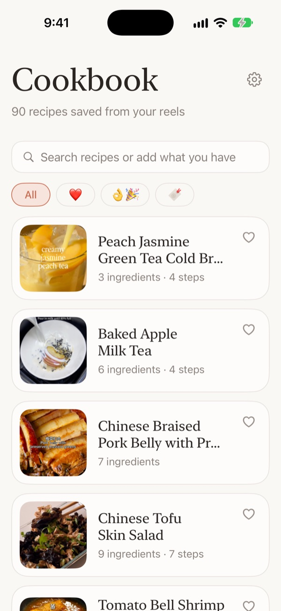
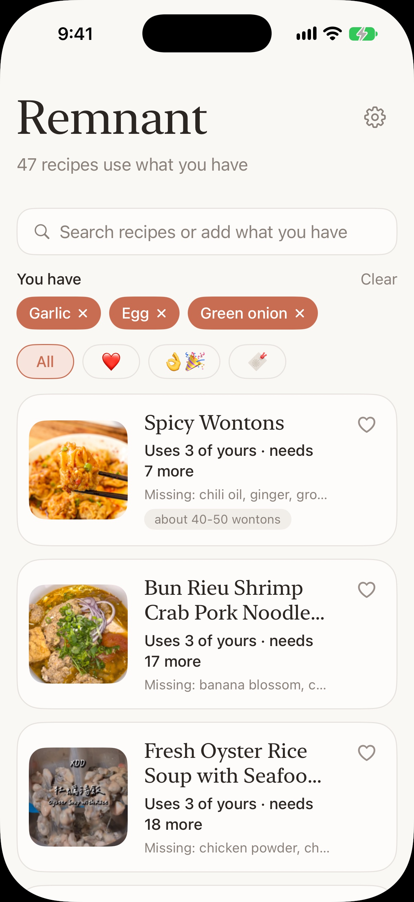
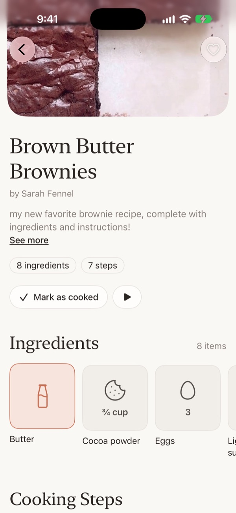
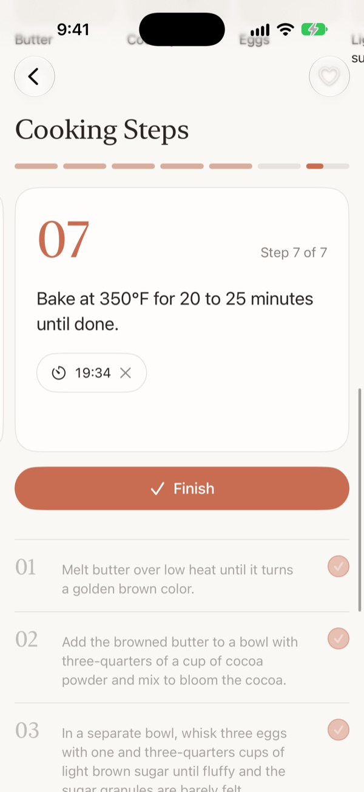
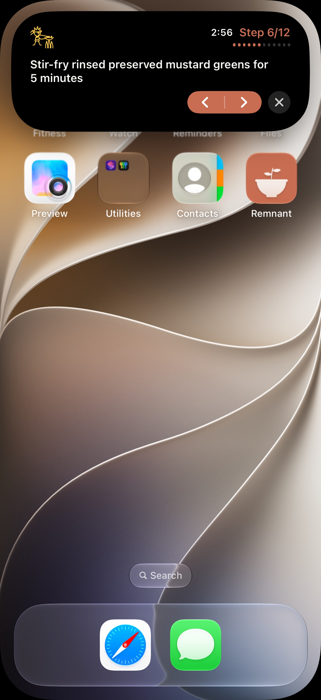
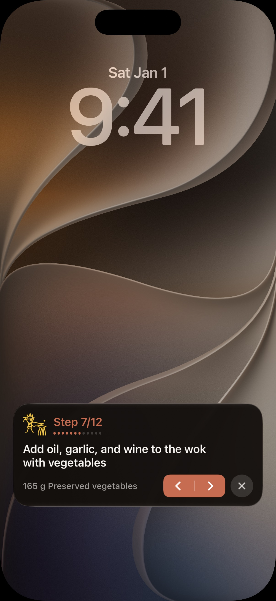
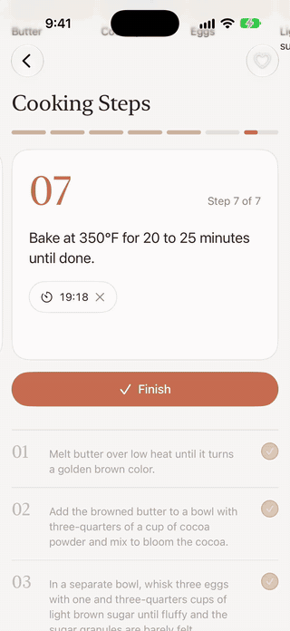
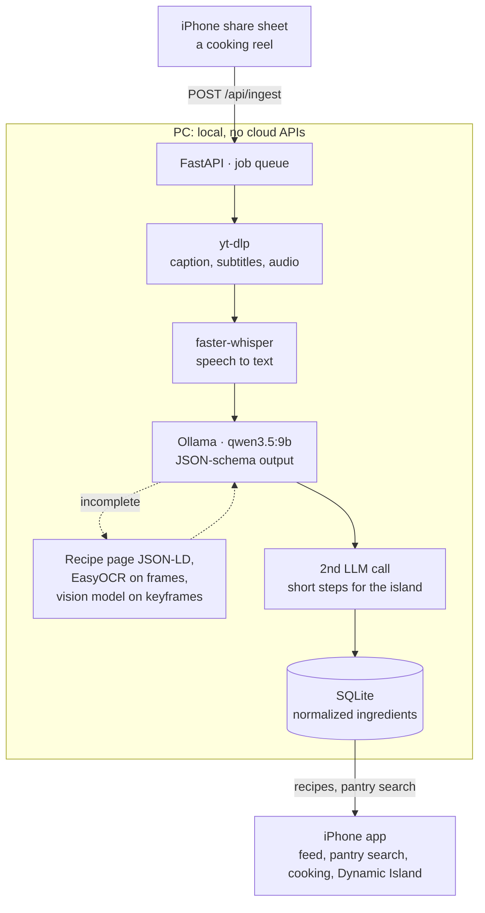

<p align="center">
  
</p>

<h1 align="center">Remnant</h1>

<p align="center"><b>Cook with what's left.</b></p>

Remnant is an iPhone app that turns the cooking reels you save into recipes you can cook from,
and tells you which ones you can make with what's left in your kitchen. Share a reel from
Instagram and a couple of minutes later it's in Remnant: ingredients, steps and timers, read
from the video's caption, speech, on-screen text, linked blog or, for silent videos, the
pictures themselves, by a local AI pipeline. Search by what's in your pantry, then cook step by
step from the Dynamic Island while the video plays. Everything runs on your own machines: no
cloud APIs.

<p align="center">
  
  
  
</p>
<p align="center">
  
  
  
</p>

<p align="center">
  
</p>

<p align="center"><sub>Leave a recipe mid-cook and the step follows: the Dynamic Island pops open
with the step and its timer. Captured in the iOS Simulator.</sub></p>

**Tech:** SwiftUI · ActivityKit / App Intents · Python · yt-dlp · faster-whisper · EasyOCR ·
Ollama (local LLM, JSON-schema output, vision) · ffmpeg · SQLite · FastAPI · pytest (260 tests)

## What it does

- **Share a reel, get a recipe.** "Remnant" in the iPhone share sheet sends the link to the
  PC, which downloads the post, transcribes it, has a local LLM extract the recipe, and saves
  it; the app shows "Adding..." and then the new recipe. Posts without a recipe yet ("link in
  bio", "coming soon") can be saved for later and checked again.
- **Multimodal extraction.** Platform captions or Whisper speech-to-text, the post's caption,
  EasyOCR on video frames when ingredients only appear on screen, the creator's blog
  (schema.org Recipe data) when the caption links one, and a vision model watching keyframes
  when nobody says the method. Non-English posts come out in English.
- **Cook from the Dynamic Island.** The current step, its ingredients and a running timer stay
  in the island and on the Lock Screen while the reel plays in Instagram, with buttons to move
  between steps. Step text there is a model-written short version of each step.
- **What can I make?** Ingredient names are normalized ("2 large eggs" and "eggs" are both
  `egg`), so picking what you have ranks recipes by how much of it they use.
- **Works offline.** The phone keeps a copy of every recipe for when the PC is off.

## How the AI pipeline works



- **Structured output from a local model.** Each parse calls Ollama's `/api/chat` with the
  pydantic model's JSON schema as `format` (constrained decoding), `temperature 0`, and
  thinking off; the reply is validated with pydantic and retried once if it doesn't fit.
  The prompt pins down the hard cases found in real posts: translate names to English
  ("蒜頭" / "ajo" -> "garlic"), keep a single batch size when a post lists several, and take
  steps only from what the post actually says.
- **Fallbacks only when needed.** A parse with fewer than 3 ingredients or no amounts counts
  as incomplete. The pipeline then tries the creator's linked recipe page (exact and cheap)
  before OCR (about 3 extra minutes on CPU), and keeps a retry only if it finds at least as
  many ingredients.
- **Watching silent videos.** When Whisper hears fewer than 5 words (silent or music-only
  reels) and the text gives no method, ffmpeg takes a keyframe every 2.5 s and at scene
  changes, with each frame's exact timestamp, and the vision model writes the steps from
  them (`step_number`, `timestamp_start`, `instruction`, `ingredients_used`). Written text
  still wins: frames only fill in missing steps, and ingredient names when there is no list.
- **A second, small model call for short steps.** The island fits about two lines, so each
  step also gets a ~50-character imperative version from the step text and ingredient names.
  With a plain list in the schema the 9B model merged ten steps into one, so the schema has
  one required key per step (`step_1`, `step_2`, ...), which makes merging impossible.
- **Normalization on both sides.** Recipe ingredients and pantry queries go through the same
  normalizer (aliases, plurals, accent folding, units), so matching relies on consistency
  rather than on the model naming things identically. The original wording is kept for display.
- **Background jobs.** Shared links queue on the PC and run one at a time (a 9B model and
  Whisper on one machine); the app polls the job and refreshes when the recipe lands.

From my own collection of 117 saved posts: 90 recipes with 922 ingredient lines (343 distinct
ingredients after normalization) and 739 steps, 99% of which have a model-written island
version (73 characters on average, 43 shortened). 260 tests run without network, Ollama or
Whisper.

## iPhone app

Native SwiftUI (iOS 17+), talking to the FastAPI server on the PC over home Wi-Fi.

- **Recipe feed** with search that also takes "what you have": ingredient chips re-rank the
  feed by the pantry query, showing what each recipe uses and what's missing. Filters for
  favorites ❤️, cooked 👌🎉 and saved-for-later 🔖; swipe left to remove (undoable).
- **Recipe screen**: photo, caption, and ingredient tiles with a black-and-white icon for each
  kind of ingredient and its amount. ▶ opens the post in its own app.
- **Cooking mode**: a step card you swipe between steps, with that step's ingredients and a
  timer read from its wording ("bake for 20 to 25 minutes" -> 20 min, with a "Time's up"
  notification). Scroll past it and a compact copy of the card pops up at the top.
- **Live Activity**, designed to Apple's Live Activity guidelines in the app's look: the step,
  its ingredients, progress and a running timer in the Dynamic Island and on the Lock Screen.
  It starts when you play the video or leave a recipe; ‹ › change the step (App Intents run in
  the app's process), ✕ ends it, closing the app ends it, and tapping it opens the recipe at
  that step. The cook in the corner is an original line drawing in a custom font, one pose
  per step.
- **Share extension** for adding reels, an **offline copy** of the feed, every recipe and its
  photo, and Settings for the server address.

Code: [`ios/`](ios/) (app, `CookingActivity` widget, `AddToCookbook` share extension; the Xcode
project and targets keep their first name, `Cookbook`, so the installed app updates in place). Build
notes: [docs/ios/README.md](docs/ios/README.md); API contract: [docs/ios/api.md](docs/ios/api.md).

## CLI demo

Real output from the same database, on the PC.

**What can I cook with what's in the fridge?** Recipes that use the most of the selected
ingredients come first; ties go to the one needing the fewest other ingredients.

```
$ python main.py pantry flour sugar "brown sugar" honey yeast eggs "baking soda" --limit 3
1. [54] Bakery Style Chocolate Chip Cookies  (uses 5 of 7 selected; +4 more)
     uses:       baking soda, egg, flour, honey, sugar
     also needs: butter, dark brown sugar, dark chocolate, pure vanilla extract
     instagram.com/p/DWZPP4xD2FE

2. [29] Black Sesame Swirl Banana Bread  (uses 5 of 7 selected; +6 more)
     uses:       baking soda, brown sugar, egg, flour, sugar
     also needs: banana, black sesame paste, buttermilk, ground cinnamon, olive oil, vanilla bean paste
     instagram.com/p/DU05oN_DkAN

3. [1] Salted Maple Banana Bread  (uses 5 of 7 selected; +6 more)
     uses:       baking soda, brown sugar, egg, flour, sugar
     also needs: banana, butter, buttermilk, maple syrup, molasses, vanilla paste
     instagram.com/p/DZlOp2nJL4I
```

**A stored recipe, parsed from the reel's caption and speech:**

```
$ python main.py show 55
Salted Maple Banana Bread
instagram.com/p/DZva78zpQuq
Ingredients from description, speech; transcript: whisper
Makes: 1 standard loaf pan

  - 0.75 cup butter
  - 1 cup brown sugar
  - 0.33 cup white sugar
  - 1.33 cup mashed banana
  - 2 egg
  - 1.5 tsp vanilla paste
  - 1 tsp molasses
  - 2 cup all-purpose flour
  - 1 tsp baking soda
  - 1 tsp salt
  - 4 oz buttermilk
  - 0.5 cup maple syrup
  - flaky sea salt
```

Salt, pepper, water and oil count as pantry staples, so they never show up as missing.
Links are shortened here; the CLI prints full URLs.

Recipes and photos by their original creators:
[Classic Japanese Bagel](https://www.instagram.com/p/CzJiZmOLfaW/) ·
[No-Yeast Youtiao](https://www.instagram.com/p/C188sW2PfKU/) ·
[Honey Butter Toast](https://www.instagram.com/p/C63hOr1ysaW/) ·
[Salted Maple Banana Bread](https://www.instagram.com/p/DZva78zpQuq/).
In the screenshots:
[Peach Jasmine Green Tea Cold Brew](https://www.instagram.com/p/Dee5z8NAwOd/) (Abril Murillo) ·
[Baked Apple Milk Tea](https://www.instagram.com/p/Dd6spZaNhT_/) (vivikitchen) ·
[Chinese Braised Pork Belly](https://www.instagram.com/p/Dd7CG0zxl3U/) (haha eats) ·
[Chinese Tofu Skin Salad](https://www.instagram.com/p/DeJe5w8JqpS/) (Angela Tracy) ·
[Peanut Streusel Bread](https://www.instagram.com/p/DXuG2_ZDdS3/) (erin) ·
[Brown Butter Brownies](https://www.instagram.com/p/Cr68aGzOMsL/) (Sarah Fennel) ·
[Souffle Omelette and Chocolate Lava Cake](https://www.instagram.com/p/DEVaQDtS2WJ/) (SauccEats).

## Layout

```
config.py              settings from RECIPE_* env vars / .env
main.py                CLI
pipeline/
  downloader.py        yt-dlp: metadata, captions (VTT -> text), audio; video for OCR
  ocr.py               ffmpeg frame sampling + EasyOCR -> distinct on-screen text lines
  frames.py            timestamped keyframes (interval + scene change) for the visual parse
  transcriber.py       faster-whisper (model cached, VAD on)
  parser.py            prompts + Ollama calls with JSON-schema output, pydantic validation
  ingest.py            orchestrates the above and saves the result
  webrecipe.py         schema.org Recipe JSON-LD from the creator's linked page
  urls.py              canonical URLs (share-link variants -> one key), batch file reading
  thumbnails.py        saves each video's thumbnail under data/thumbnails/
api/
  app.py               FastAPI JSON server for the iPhone app
  jobs.py              background queue for links shared from the phone
ios/                   SwiftUI app, Live Activity widget, share extension (Xcode project)
db/
  schema.py            recipes / ingredients / recipe_ingredients / recipe_steps + connect()
  normalize.py         canonical ingredient names and units
  repository.py        save_recipe (upsert by URL), get_recipe, list_recipes, marks
  pantry.py            find_recipes_by_pantry
  step_ingredients.py  which ingredient lines each step mentions
tests/
```

## Setup

Prerequisites: Python 3.10+, [Ollama](https://ollama.com), and ffmpeg on PATH (yt-dlp
uses it for some sites).

```powershell
# Windows PowerShell
python -m venv .venv
.\.venv\Scripts\Activate.ps1
pip install -r requirements-dev.txt
copy .env.example .env      # optional
ollama pull qwen2.5:7b      # or qwen3.5:9b, which this demo uses
```

```bash
# macOS / Linux / Git Bash
python -m venv .venv
source .venv/bin/activate        # Git Bash on Windows: source .venv/Scripts/activate
pip install -r requirements-dev.txt
cp .env.example .env
ollama pull qwen2.5:7b      # or qwen3.5:9b, which this demo uses
```

The first transcription downloads the Whisper model (`small` is about 500 MB) into the
Hugging Face cache.

**On-screen text (optional):** `pip install -r requirements-ocr.txt` adds EasyOCR (and CPU
PyTorch, a few hundred MB; its models download on first use). With `RECIPE_OCR=auto`
(default), a video whose description and speech give fewer than 3 ingredients, or no
amounts, is downloaded again as video, sampled at `RECIPE_OCR_FPS` (near-identical frames
dropped, at most `RECIPE_OCR_MAX_FRAMES`), OCR'd, and re-parsed with that text. This adds
a few minutes per video on CPU. `RECIPE_OCR=always` does it for every video, `off` never.
Without EasyOCR installed the fallback is skipped with a warning.

**Silent videos:** with `RECIPE_VISUAL=auto` (default), a video with fewer than
`RECIPE_VISUAL_MIN_WORDS` spoken words whose text gives no steps (or an incomplete recipe) is
downloaded as video, up to `RECIPE_VISUAL_MAX_FRAMES` keyframes are sent to
`RECIPE_VISUAL_MODEL` (default: the parsing model), and its steps are stored with the second
each one starts (`recipe_steps.start_seconds`). The model needs image input; with a text-only
model the call fails and the fallback is skipped with a warning. `reparse` keeps these steps.
For recipes saved before this existed, `python main.py video-steps --dry-run` lists the
silent ones without steps, and `python main.py video-steps` reads their videos (`--todo`
includes the needs-recipe list).

**GPU transcription:** set `RECIPE_WHISPER_DEVICE=cuda` and `RECIPE_WHISPER_COMPUTE_TYPE=float16`.
This needs the CUDA 12 cuBLAS and cuDNN 9 libraries; see the faster-whisper README.

## Usage

```bash
python main.py ingest "https://www.youtube.com/shorts/<id>" "https://www.instagram.com/reel/<id>/"
python main.py batch --file urls.txt            # add --refresh to re-parse stored URLs
python main.py list                            # recipes ready to cook
python main.py list --todo                     # posts whose recipe is on a blog / in the bio / by DM
python main.py list --all                      # everything, including non-recipe videos
python main.py show 1
python main.py import-page 34                  # read a post's ingredients from its linked blog recipe
python main.py import-page 63 --url https://...   # ... or from a recipe page you found yourself
python main.py import-page 39 --file "Lemon Curd Cookies.html"   # site blocks the app: save the page (Ctrl+S)
python main.py import-page 45 --file ingredients.txt               # ... or paste the ingredient list
python main.py reparse 12 15                   # run the model again on saved recipes (no download)
python main.py reparse --missing-steps         # add steps to recipes saved before steps existed (~2 min each)
python main.py renormalize --dry-run          # re-apply name normalization to stored recipes
python main.py thumbnails                      # save missing video thumbnails (shown in the app)
python main.py search --ingredients "chicken, garlic, soy sauce, rice, eggs" --limit 10
python main.py pantry eggs butter --json        # same query, space-separated
```

**Duplicates.** Recipes are keyed by a canonical URL, so `/reel/<id>/?igsh=...` and
`/p/<id>/` (or `youtu.be/<id>` and `/shorts/<id>`) are the same recipe. `ingest`
re-parses and updates a stored URL (`--skip-existing` skips it); `batch` skips stored
URLs before downloading unless `--refresh` is given, and also skips repeats within the
file. A batch file can mix notes and links (`Banana bread: https://...`): only URLs are
used (`http(s)://...` or bare `instagram.com/...`-style links), and text after a `#` is a
comment, so `# https://...` skips that link. The run reports how many lines had no URL.
Failed URLs are reported and the run continues; the exit code is 1 if any failed.

**Search results** include every recipe that uses at least one selected ingredient (what
you have, or what you feel like eating). Recipes using the most of the selection come first;
ties go to the one needing the fewest other ingredients. Each result lists which selected
ingredients it uses and what else it needs. Use `--limit` to keep long lists short.

Pantry matching normalizes both sides the same way: "2 large eggs" and "eggs" both
become `egg`, and "scallions" becomes `green onion`. Staples listed in
`RECIPE_PANTRY_STAPLES` (salt, black pepper, water and oil by default) are left out of
the scoring. Pass `--no-staples` to count them.

From Python:

```python
from db import connect, find_recipes_by_pantry
conn = connect("data/recipes.db")
for m in find_recipes_by_pantry(conn, ["chicken", "garlic", "rice"], limit=5):
    print(m.title, f"uses {m.matched} of {m.selected}", m.missing)
```

## Running the app

The backend runs on a computer that can handle Whisper and a 9B model (mine is a Windows PC);
the iPhone reaches it over Wi-Fi.

```bash
python main.py thumbnails                        # once: thumbnails for recipes stored earlier
uvicorn api.app:app --host 0.0.0.0 --port 8000   # from the project root, with the venv active
```

Then open `ios/Cookbook.xcodeproj` in Xcode, set the signing team, and run it on an iPhone
(iOS 17+) on the same Wi-Fi. Set the server address in the app's Settings, and in
`AddToCookbook/ShareViewController.swift` for the share sheet. With a free Apple ID the install
lasts 7 days. Full walkthrough: [docs/ios/README.md](docs/ios/README.md).

API: `GET /api/recipes[?status=ready|todo|all]`, `GET /api/recipes/{id}`,
`PATCH /api/recipes/{id}` (favorite, tried, hidden, status), `GET /api/recipes/{id}/thumbnail`,
`GET /api/ingredients`, `GET /api/pantry?have=a&have=b`, `POST/GET /api/ingest`. Full contract
with sample responses: [docs/ios/api.md](docs/ios/api.md). New ingests save their thumbnail
automatically; marks live in the `recipes` table and survive re-ingesting.

## Configuration

All settings are optional. See `.env.example`.

| Variable | Default | Notes |
|---|---|---|
| `RECIPE_DATA_DIR` | `data` | DB and temporary downloads |
| `RECIPE_OLLAMA_MODEL` | `qwen2.5:7b` | Any Ollama model that handles JSON output |
| `RECIPE_OLLAMA_NUM_CTX` | `8192` | Context window passed to Ollama |
| `RECIPE_OLLAMA_THINK` | `false` | Turns off reasoning on thinking models (much faster). `default` leaves it to the model |
| `RECIPE_WHISPER_MODEL` | `small` | `base` is faster, `medium`/`large-v3` are more accurate |
| `RECIPE_PREFER_CAPTIONS` | `true` | Use platform captions when present, skip Whisper |
| `RECIPE_KEEP_MEDIA` | `false` | Keep downloaded audio/caption files |
| `RECIPE_PANTRY_STAPLES` | `salt,black pepper,water,oil` | Ignored when scoring |

## Tests

```bash
pytest
```

The tests cover normalization, the DB and pantry query, prompt and response
handling (with Ollama mocked), and caption parsing. They don't need network access,
Ollama, or a Whisper model.

## License

MIT. See [LICENSE](LICENSE).
